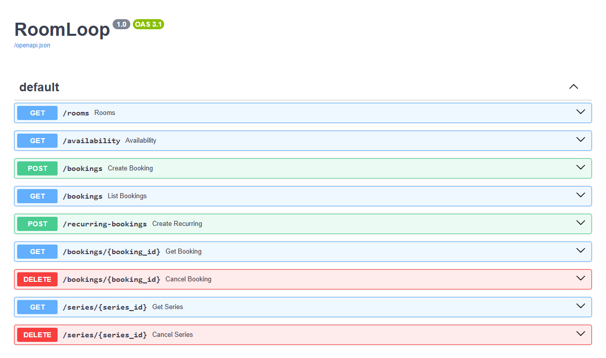
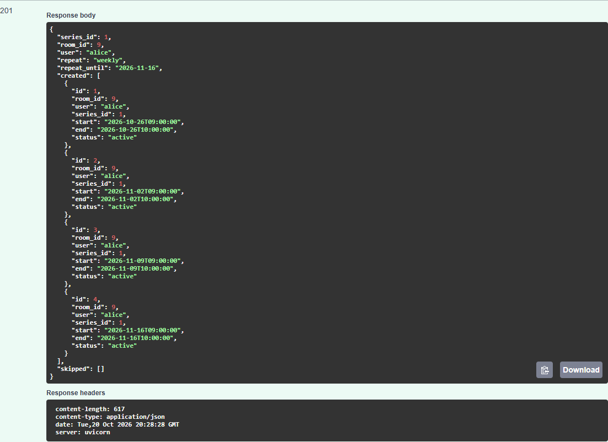
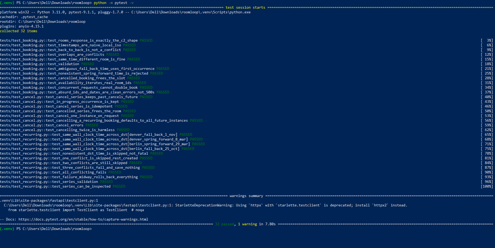

# RoomLoop Booking Service

A small REST API for booking meeting rooms: single bookings, weekly recurring bookings, and cancellation. Python, FastAPI, SQLite.

**Why a REST API (not a CLI):** other internal tools already consume an HTTP API (the facilities dashboard calls `GET /rooms`), so keeping an HTTP surface means they can keep working. The server also puts all writes behind one place, which is where the conflict checks need to be atomic.

## Run it

```bash
python -m venv .venv
.venv\Scripts\activate          # macOS/Linux: source .venv/bin/activate
pip install -r requirements.txt

python -m pytest -v             # 32 tests
uvicorn roomloop.app:create_app --factory --port 8000
```

Interactive docs: http://localhost:8000/docs. The database is `roomloop.db` in the working directory (override with `ROOMLOOP_DB`). Delete it to start fresh; it is recreated and the four rooms are re-seeded.

## Endpoints

| Method | Path | Purpose |
|---|---|---|
| GET | `/rooms` | `[{id, name, capacity}]` (exactly these fields) |
| GET | `/availability?start=&end=` | Rooms free for a window |
| POST | `/bookings` | Create a single booking |
| POST | `/recurring-bookings` | Create a weekly series |
| GET | `/bookings`, `/bookings/{id}` | List (`?room_id=`, `?include_cancelled=true`) / fetch |
| DELETE | `/bookings/{id}` | Cancel a booking. If it belongs to a recurring series, all future instances are cancelled and past ones kept; add `?scope=instance` to cancel only that occurrence |
| GET | `/series/{id}` | Series and its bookings |
| DELETE | `/series/{id}` | Cancel a whole series (future instances only) |

Times are **naive local ISO strings**, local to the room's office, e.g. `2026-07-02T09:00:00`. Offsets and `Z` are rejected.

```json
POST /recurring-bookings
{"room_id": 9, "start": "2026-10-26T09:00:00", "end": "2026-10-26T10:00:00",
 "user": "alice", "repeat": "weekly", "repeat_until": "2026-11-16"}
```
Response: `{series_id, created: [...], skipped: [{start, end, reason, conflicts_with?}]}`.

## Examples

(Bash-style `curl`; on Windows PowerShell use `curl.exe` and escape the quotes, or just use `/docs`.)

```bash
# 1. Single booking (Denver room Cinder, local time)
curl -X POST localhost:8000/bookings -H "Content-Type: application/json"   -d '{"room_id":9,"start":"2026-07-02T09:00:00","end":"2026-07-02T10:00:00","user":"alice"}'

# 2. Weekly series: every Monday 09:00 until 16 Nov (crosses the 1 Nov DST change in Denver)
curl -X POST localhost:8000/recurring-bookings -H "Content-Type: application/json"   -d '{"room_id":9,"start":"2026-10-26T09:00:00","end":"2026-10-26T10:00:00","user":"alice","repeat":"weekly","repeat_until":"2026-11-16"}'

# 3. Get rid of the whole series (future occurrences are cancelled, past ones stay)
curl -X DELETE localhost:8000/series/1

# 4. Which rooms are free for a window?
curl "localhost:8000/availability?start=2026-07-02T09:00:00&end=2026-07-02T10:00:00"
```

## Responses and errors

| Status | When | Body |
|---|---|---|
| 201 | Booking or series created | The booking, or `{series_id, created, skipped}` |
| 200 | Cancel, read, list | Cancel returns `{booking_id, cancelled}` or `{series_id, cancelled, kept}` |
| 404 | Unknown room, booking or series id | `{error: "not_found", message}` |
| 409 | Room already booked; or a series where more than 2 occurrences clash / none can be booked (nothing saved) | `{error: "conflict", message, conflicts_with}` or `{..., skipped: [...]}` |
| 422 | Bad input: end not after start, offset or `Z` in a time, unsupported repeat, series over 53 occurrences, ids or dates out of range, missing fields | `{error: "invalid_input", message}` (missing fields use FastAPI's `{detail: [...]}`) |

Each entry in `skipped` is `{start, end, reason, conflicts_with?}`, where `reason` is `conflict` or `nonexistent_local_time` (a DST spring-forward gap).

## How it works

- **Data model (SQLite):** `rooms(id, name, capacity, office)`, `series(...)`, `bookings(room_id, user, series_id, start_utc, end_utc, start_local, end_local, status)`. Each room belongs to an office (Berlin or Denver), which gives its timezone. The office is never returned by the API.
- **Two representations of every time:** `start_local`/`end_local` are the naive local strings returned to callers (C1). `start_utc`/`end_utc` are epoch seconds used only for overlap checks and for deciding what is "in the future".
- **Conflict check:** two bookings in the same room conflict when `existing.start < new.end AND existing.end > new.start`. Cancelled bookings are ignored, so a cancelled slot can be booked again.
- **Atomic writes:** creating a booking or series runs in one `BEGIN IMMEDIATE` transaction, so the conflict check and the insert cannot be interleaved by another request (tested with 8 concurrent requests for the same slot, exactly one succeeds).
- **Why recurrence does not drift across DST:** Denver 09:00 on 26 Oct (MDT) is 15:00 UTC, but 09:00 on 2 Nov (MST) is 16:00 UTC. The code steps the *local date* by 7 days and converts each result to UTC separately, so the local time stays 09:00 and the UTC time changes. Adding a fixed 7x24h to the UTC instant would instead give 08:00 local after the clocks change.
- **Cancelling:** bookings are never deleted. Cancelling sets `status='cancelled'`, so reports still see history. For a series, only occurrences that have not started are cancelled.

## How the brief's requirements are handled

- **R1 all-or-nothing:** a recurring booking is created in one database transaction. Any failure rolls back the whole series, including the series row.
- **R2 skip clashes:** up to **2** clashing occurrences are skipped and reported in `skipped`. If more clash, or none can be booked, the request fails with `409` and nothing is saved.
- **R3 same wall-clock time:** the *local* date is stepped by 7 days and the local clock time is kept. Adding 7x24h to a UTC instant would shift bookings by an hour after a DST change. Tests cover the 2026 changes in Berlin and Denver (`test_data/dst_scenarios.json`).
- **R4 conflicts:** intervals are half-open `[start, end)`, so back-to-back bookings do not conflict. Overlap is checked on UTC instants, not on local strings.
- **R5 room ids:** not followed. The real room ids are not sequential (3, 4, 9, 17), so looping 1..N would miss rooms and probe rooms that do not exist. Availability iterates the rooms that exist.
- **C1 timestamps:** the local strings are stored and returned exactly as given. UTC is only used internally.
- **C2 `/rooms`:** returns exactly `{id, name, capacity}`. The office (timezone) is stored but never exposed.
- **Office Manager (stuck series):** `DELETE /series/{id}` removes a whole series in one call. Past and in-progress occurrences are kept; future ones are cancelled and free the room.

## Screenshots

**The API** (`/docs`, generated by FastAPI):



**Weekly Denver series across the 1 Nov clock change.** Request: room 9, Monday 26 Oct 09:00-10:00, weekly until 16 Nov. Every occurrence stays at 09:00 local, including the ones after the change. Adding 7x24h in UTC would have shown 08:00 from 2 Nov, which is the "an hour off" bug from the brief.



**Tests** (`python -m pytest -v`): all 32 pass.



## Layout

```
roomloop/timeutil.py   local <-> UTC conversion, DST handling
roomloop/db.py         schema and seed rooms
roomloop/service.py    booking rules (no HTTP)
roomloop/app.py        FastAPI endpoints
tests/                 32 tests
test_data/             DST scenarios
docs/                  screenshots used in this README
DECISIONS.md           decisions, open questions, AI use, what is next
```

## Limitations and next steps

- No authentication: anyone can cancel anyone's series (see questions in `DECISIONS.md`).
- Weekly repeats only; no editing or moving of bookings; no pagination on `GET /bookings`.
- SQLite is fine for one small service; for more load, move to Postgres with an exclusion constraint on room and time range as a second guard against double booking.
- Room-to-office assignment is an assumption (the brief does not say where each room is).
